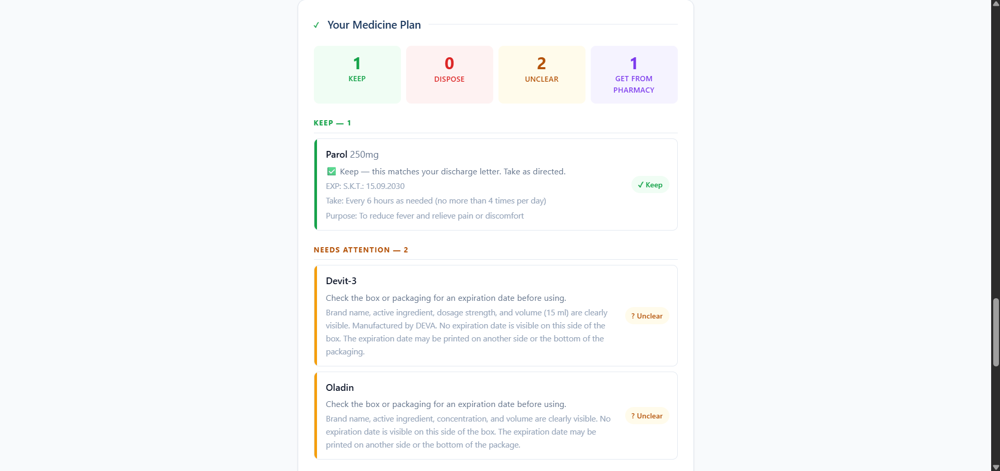
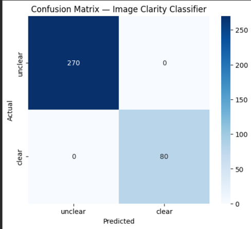
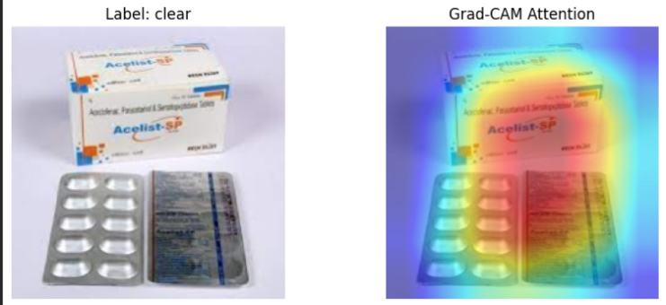

# Cabinet Clear

**Understand your discharge letter. Make sense of your medicine cabinet.
Know when to ask a pharmacist.**

Cabinet Clear is a bilingual, AI-assisted health-literacy application
designed to help people understand hospital discharge instructions and
organize the medicines they already have at home. It connects
information from a discharge letter with medicine-label information,
highlights possible discrepancies, and encourages users to confirm
uncertain decisions with a pharmacist or healthcare professional.

> **Live demo:** [https://cabinetclear.vercel.app\](https://cabinet-clear-kjwl5au53-zeynepceyhun152-codes-projects.vercel.app/)

> It's 11 p.m. Maya, 9, is finally asleep after an asthma flare-up. Her dad is sitting at the kitchen table with a discharge letter full of dosing instructions in one hand and a drawer of old inhalers and amoxicillin bottles in the other, trying to figure out which ones are safe to use tonight and which ones have been expired since last winter. Cabinet Clear is built for that exact moment.

<p align="center">
  
</p>

## Recognition

-   **USAII Global AI 2026 --- 3rd Place**, 

## Table of Contents

- [The problem](#the-problem)
- [What Cabinet Clear does](#what-cabinet-clear-does)
- [How it works](#how-it-works)
- [AI and software components](#ai-and-software-components)
- [The image-classification model](#the-image-classification-model)
- [Testing and evaluation](#testing-and-evaluation)
- [Responsible use and limitations](#responsible-use-and-limitations)
- [Technology stack](#technology-stack)
- [Run locally](#run-locally)
- [Project timeline](#project-timeline)
- [AI usage disclosure](#ai-usage-disclosure)
- [Author](#author)
- [Disclaimer](#disclaimer)

## The problem

After a medical appointment or hospital discharge, people may receive
instructions that are difficult to understand while they are stressed,
tired, or overwhelmed. At home, they may also face a cabinet of medicine
packages with unfamiliar names, similar-looking labels, or confusing
expiry information.

I became interested in this problem after experiencing how difficult
medical information can be to process during an emotionally stressful
situation. My mother is a doctor, but medical knowledge does not
eliminate the difficulty of trying to understand and act on information
when you are personally affected by it. Cabinet Clear grew from that
experience: I wanted to build a tool that makes the next steps easier to
understand without pretending to replace a clinician or pharmacist.

## What Cabinet Clear does

### 1. Reads discharge instructions

Users can provide discharge-letter content as pasted text, a PDF, or a
photo. The application extracts key information such as:

-   Diagnoses and relevant context
-   Medicines and instructions mentioned in the letter
-   Follow-up appointments or actions
-   Warning signs and situations where medical help may be needed

The extracted information is presented in more accessible language.
Users should compare the result with the original letter and contact
their care team when anything is unclear.

### 2. Adapts explanations to the user

Cabinet Clear asks brief questions about how overwhelmed or confident
the user feels. It uses the responses to adjust the length and style of
its explanation. The goal is to make information more manageable, not to
make medical decisions on the user's behalf.

### 3. Checks medicine-photo clarity before extraction

A custom image-classification model checks whether a medicine-package
photo is clear enough for the next step. If the photo is rejected,
Grad-CAM visualizations help inspect which image regions influenced the
model's prediction.

Users can submit a package's front label and a separate expiry-date
photo. A rejected or unclear image should be retaken rather than treated
as reliable evidence.

### 4. Matches medicine names

The application uses a shared list of 311 brand and generic names,
including Turkish spellings, together with fuzzy matching to help
connect different names for the same medicine. Matching logic is tested
against a large set of name pairs to reduce accidental merges between
distinct medicines.

Name matching is not proof that two packages contain the same product.
The label and medicine details still need to be checked.

### 5. Helps organize a medicine cabinet

Based on available label and expiry information, Cabinet Clear groups
items into review categories such as **Keep**, **Dispose**, **Unclear**,
or **Ask a Pharmacist**. It can flag expiry concerns and selected
possible interaction warnings.

These are prompts for review, not instructions to start, stop, discard,
or combine medicines. Users should confirm uncertain items and any
medication changes with a pharmacist or qualified healthcare
professional.

### 6. Compares medicine lists

Rule-based Python logic compares medicines mentioned before discharge
with the discharge list to identify possible additions, removals, or
changes. This is intended to help users prepare questions for their
healthcare team.

### 7. Supports practical follow-through

Other features include:

-   A PDF summary that can be taken to a pharmacist
-   Thirteen trusted health-resource links selected by rules
-   English and Turkish interfaces
-   Progressive Web App (PWA) support
-   Optional accounts and saved history
-   Encrypted saved history and account deletion

Feature availability can depend on the deployment and configuration.

## How it works

Cabinet Clear deliberately combines language-model assistance with
deterministic application logic. The language model is useful for
interpreting unstructured text, while explicit Python rules are used for
tasks that benefit from predictable comparisons.

``` text
Discharge letter / medicine photos
              |
              v
     Input processing and checks
              |
      +-------+----------------+
      |                        |
      v                        v
Claude API                Custom ResNet18 CNN
letter/label extraction   photo-clarity check
and plain-language output         |
      |                           v
      |                    Accept / retake photo
      +------------+--------------+
                   |
                   v
       Python rules and reference data
       - medicine-name matching
       - expiry checks
       - selected interaction warnings
       - pre-/post-discharge comparison
       - trusted-resource selection
                   |
                   v
      Reviewable results and PDF summary
```

The diagram is a high-level overview. It does not mean that every
feature runs in a single linear sequence.

## AI and software components

  -----------------------------------------------------------------------
  Component                           Purpose
  ----------------------------------- -----------------------------------
  Claude API                          Extracts information from discharge
                                      letters and medicine labels and
                                      generates plain-language
                                      explanations

  Custom ResNet18 CNN                 Classifies whether a
                                      medicine-package photo is
                                      sufficiently clear for further
                                      processing

  Grad-CAM                            Helps visualize image regions
                                      associated with a CNN prediction

  Python rules                        Handles medicine-name matching,
                                      expiry checks, selected interaction
                                      warnings, and medication-list
                                      comparison

  PostgreSQL / SQLite                 Stores application data and
                                      history, depending on the
                                      environment

  FastAPI                             Backend API

  React-based frontend                User interface and deployed web
                                      experience
  -----------------------------------------------------------------------

The application does not rely on the language model for every decision.
Deterministic rules handle several comparison and validation tasks.
Those rules can still be incomplete, and the AI-generated output can
still be wrong.

---

## The CNN, In Depth

This is the one part of the app that is a neural network I trained myself, not an API call.

### Why it exists

Anyone can send a photo to an AI. But if the photo is blurry, dark, or too far away, the AI can guess, and a guessed drug name or expiry date is dangerous. So before the AI sees a medicine photo, my CNN answers one simple question: **is this photo clear enough to read?**

- **Trust score.** The CNN gives each photo a number between 0 (unclear) and 1 (clear): how confident it is that the photo can be read.
- **Grad-CAM image.** A heat map shows where the CNN looked. If a photo is rejected, you see this map, so you can tell what was wrong (often the expiry date, a small low-contrast stamp) and retake just that shot.

### How I built it

- **Model:** ResNet18, an existing image model already trained on millions of photos (ImageNet). I kept its early layers as they were, and retrained its last block plus a new final layer that outputs the trust score.
- **Training:** 8 rounds, Google Colab with a T4 GPU.
- **Why a classifier and not a segmentation model:** the question is "clear or not" for the whole photo, one label per image, so a classifier is the right tool.

| | |
|---|---|
| **Base images** | 437 photos of medicine tablets and boxes from the Kaggle dataset "Medicine tablet pack image dataset" (see Credits) |
| **Unclear versions** | From each clear photo I made 3 unclear ones: blurred, darkened (poor lighting), and shrunk then enlarged (taken too far away) |
| **Total** | 1,748 images (437 clear + 1,311 unclear) |
| **Training / validation** | 1,398 / 350 |

### Results

```
              precision    recall   f1-score
   unclear        1.00      1.00      1.00
     clear        1.00      1.00      1.00
```

<p align="center">
  
</p>

**What this number really means:** a perfect score is too good to fully trust, because the unclear photos were made from the same clear photos the model learned from. It may partly recognize "a blurred copy of something I saw" instead of blur in general. In live tests it did reject blurry photos I took fresh on a phone. It was also trained on one small set of mostly Indian medicine packs, so it still needs testing on more varied photos from other people.

### Checking that it learned the right thing

A model can get the right answer for the wrong reason, like linking a tabletop texture to "clear". Grad-CAM lets me check. In the image below, warm colors (high attention) sit on the printed text of the label, not the background, which is evidence the CNN learned to judge the text.

<p align="center">
  
</p>

---

## Testing and evaluation

The project includes developer-created tests for core logic and known
failure cases. These tests are useful for checking implementation
behavior, but they are not clinical validation or an independent audit.

Reported test results include:

-   **Medication-list comparison:** 35 test cases covering 50 medicines;
    50/50 correct in the tested cases, compared with 24/50 using a
    plain-text comparison baseline.
-   **Medicine-name matching:** All pairs from the 311-name reference
    list were checked, representing more than 160,000 pairwise
    comparisons. After fixing a citalopram/escitalopram matching issue,
    no distinct medicines were merged in that test set.
-   **Explanation checking:** 47 deliberately corrupted explanations
    were detected in the project's tests.
-   **Security and storage:** Application tests were run for
    saved-history access and related storage behavior, including a fix
    for a prior issue where history could be accessed by guessing a
    username.

These results describe the project's own test cases. They do not show
that every medication, interaction, expiry date, or generated
explanation will be handled correctly. The application has not been
independently clinically validated or independently security-audited.

## Responsible use and limitations

Cabinet Clear is a health-literacy and organization tool, not a medical
device or a substitute for professional care.

-   AI may omit, misread, or invent information.
-   A photo-clarity prediction does not verify the identity or contents
    of a medicine package.
-   Medicine-name matching may produce false matches or miss equivalent
    names.
-   Expiry information and interaction warnings may be incomplete or
    incorrect.
-   The application cannot determine whether a medicine is appropriate
    for a particular person.
-   Do not start, stop, change, combine, or discard medication based
    only on Cabinet Clear.
-   Confirm uncertain information and medication decisions with a
    pharmacist or healthcare professional.
-   For urgent or severe symptoms, seek appropriate medical care rather
    than relying on the application.

The interface is designed to surface uncertainty and encourage review,
but those safeguards do not eliminate risk.

## Technology stack

-   **Frontend:** React-based web application
-   **Backend:** Python, FastAPI
-   **Language model integration:** Claude API
-   **Computer vision:** PyTorch, ResNet18, Grad-CAM
-   **Data and storage:** PostgreSQL through Neon in the deployed setup;
    SQLite for local development
-   **Deployment:** Vercel frontend and Render backend
-   **Additional capabilities:** PDF export, PWA support, optional
    accounts, English/Turkish support

## Run locally

The exact environment variables and commands may change as the project
evolves. Check the repository's current files before running the
application.

1.  Clone the repository:

    ``` bash
    git clone https://github.com/zeynepceyhun152-code/cabinet-clear-with-a-better-frontend.git
    cd cabinet-clear-with-a-better-frontend
    ```

2.  Inspect the frontend and backend directories and their dependency
    files.

3.  Configure the environment variables required by the current backend,
    including the Claude API key and any database or authentication
    settings. Do not commit API keys or secrets to version control.

4.  Install the dependencies specified by the project and start the
    backend and frontend using the commands documented in their
    respective configuration files.

5.  For local development, use synthetic discharge letters and sample
    medicine images. Do not use real patient data in development or
    testing.

## Project timeline

Cabinet Clear developed through multiple iterations from June to October 2026. The milestones below summarize the progression; they are not a claim that every feature was completed on a single date.

| Period | Development |
|---|---|
| **June 2026** | Built the initial version of Cabinet Clear around helping users understand discharge instructions and make sense of medicine information. |
| **Following iterations** | Expanded the medicine-cabinet workflow with medicine-name matching, expiry checks, selected interaction warnings, and a PDF summary for pharmacist discussions. |
| **Later development** | Added medication-list comparison to help surface possible differences between pre-discharge and discharge medicine lists. |
| **Later development** | Added adaptive explanations, trusted-resource links, and broader English/Turkish support. |
| **October 2026** | Continued refining the interface, optional saved history, account and storage protections, and the overall deployed experience. Also documented testing results and remaining evaluation limitations. |

I also tested approaches that did not generalize well and chose not to keep them as core functionality. The project continues to have limitations, particularly around independent evaluation of the photo-clarity model and the reliability of health-related outputs.

## Credits

- **Anthropic Claude API** for language and image understanding · **OpenFDA** for drug label data.
- **PyTorch**, **torchvision**, **pytorch-grad-cam**, **FastAPI**, **fpdf2**, **thefuzz**, **bcrypt**, **cryptography**, **pg8000**.
- **Neon** (database), **Render** (server) and **Vercel** (web page) for hosting.
- **DejaVu Sans** font (in `backend/fonts`, with its license) for Turkish letters in PDFs.
- CNN training photos: "Medicine tablet pack image dataset" by nitesh31mishra on Kaggle (https://www.kaggle.com/datasets/nitesh31mishra/medicine-tablet-pack-image-dataset). The dataset itself is not in this repository.
- The discharge letters in `sample_data/` are made up, for testing.

---

## AI usage disclosure

**Inside the app:** The Claude API (Anthropic) reads discharge letters and medicine labels and writes the plain-language explanations. Code around it checks its work, as described above.

**While building it:** I developed Cabinet Clear myself, including its core application logic, backend, medicine-matching and sorting rules, CNN training and integration, PDF export, account functionality, and frontend implementation. During development, I used Claude as a debugging assistant and for minor visual adjustments to the frontend.


## Author

**Zeynep Ceyhun**\
GitHub: [zeynepceyhun152-code](https://github.com/zeynepceyhun152-code)

## Disclaimer

Cabinet Clear is an educational software project. It is not intended to
diagnose, treat, or prevent any disease, and it does not replace a
doctor, pharmacist, emergency service, or official medication
instructions. Always verify medicine information with a qualified
healthcare professional.
